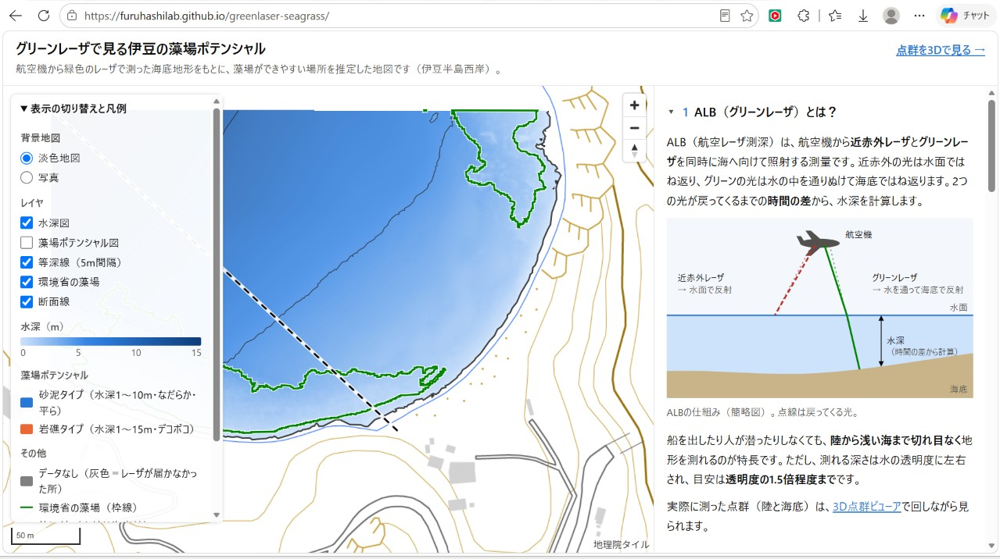
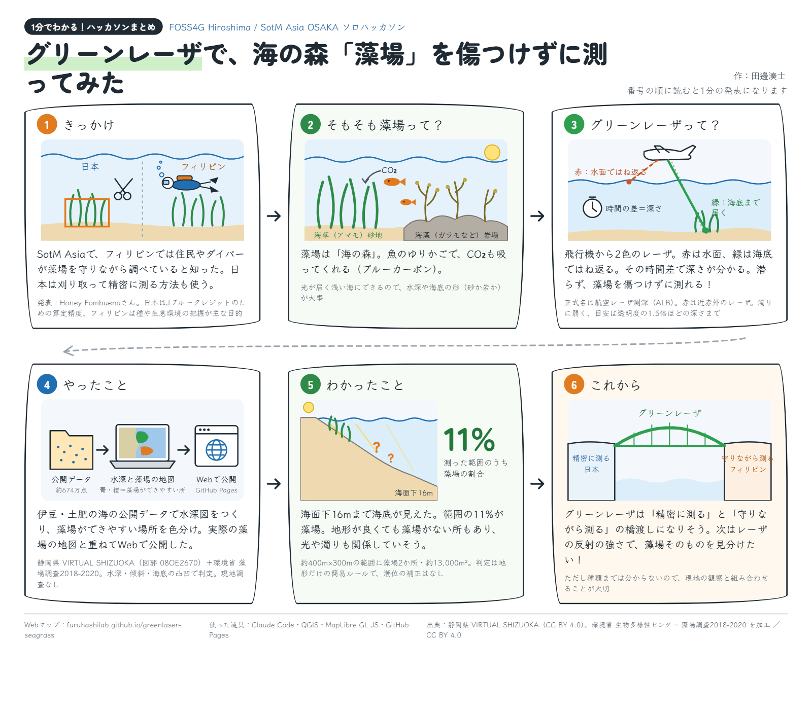

# グリーンレーザ(ALB)で見る伊豆の藻場ポテンシャル



**公開ページ**

- Webマップ：https://furuhashilab.github.io/greenlaser-seagrass/
- 3D点群ビューア：https://furuhashilab.github.io/greenlaser-seagrass/3d.html
- データ調査メモ：https://furuhashilab.github.io/greenlaser-seagrass/notes.html

## グラレコ（作業のまとめ）



## 目的

SotM Asia OSAKA での Honey Fombuena さんの発表をきっかけに、藻場を壊さずに広い範囲を測れるグリーンレーザ（ALB：航空レーザ測深）の点群データを初めて使ってみるソロハッカソンです。伊豆半島西岸（土肥付近）の海底地形から、藻場ができやすい場所（藻場ポテンシャル）を簡単なルールで推定し、環境省の藻場分布と比べました。

## 使った技術

| 技術 | 使いどころ |
|---|---|
| ALB（航空レーザ測深） | 陸と浅い海の海底地形を、点群としてまとめて測ったデータ |
| Python | データ処理（`scripts/`） |
| laspy | LAS形式の点群ファイルの読み込み |
| rasterio | 地形データ（GeoTIFF）の作成・座標変換・PNGへの書き出し |
| MapLibre GL JS | Webマップの表示（`docs/index.html`） |

ほかに numpy、geopandas、shapely、matplotlib（Python）、deck.gl（3D点群ビューア `docs/3d.html`）を使っています。

## 処理の流れ

| 順番 | スクリプト | やること | おもな出力 |
|---|---|---|---|
| 1 | `scripts/01_make_dem.py` | 提供元のグリッドデータ（0.5m間隔）から、1m間隔の地形データ（DEM）を作る | `data/work/dem.tif` |
| 2 | `scripts/02_analyze.py` | 水深・傾斜・ざらつき（凸凹）を計算し、藻場ポテンシャル（砂泥タイプ・岩礁タイプ）を区分する | `data/work/depth.tif` ほか |
| 3 | `scripts/03_compare.py` | 環境省の藻場と、水深・ポテンシャルを比べる | `docs/data/stats.json`、`docs/data/depth_hist.png` |
| 4 | `scripts/04_export_web.py` | Webマップ用に、色付きPNG・等深線・藻場・断面・間引いた点群を書き出す | `docs/data/` |

データの中身を調べたスクリプト（`scripts/inspect_las.py`、`scripts/inspect_moba.py`）と、くわしい結果は [docs/notes.md](docs/notes.md) にあります。

### 動かし方

```
py -3.12 -m venv .venv
.venv\Scripts\python -m pip install "laspy[lazrs]" numpy rasterio geopandas shapely py7zr matplotlib
.venv\Scripts\python scripts/01_make_dem.py
.venv\Scripts\python scripts/02_analyze.py
.venv\Scripts\python scripts/03_compare.py
.venv\Scripts\python scripts/04_export_web.py
```

元データは `data/raw/alb/`（ALBのzip）と `data/raw/moba/mo2018_utm54/`（藻場Shapefile）に置き、ALBのzipを `data/work/alb/` に展開しておきます。

## 限界

- **潮位補正をしていない**：標高0m（東京湾平均海面と推定）より低い所を海としました。
- **簡易ルールである**：水深・傾斜・ざらつきだけで判定しています。ざらつきの「大・小」の境目は、海域の中央値（0.0414m）です。
- **時期のずれ**：この範囲の藻場データは2013年の衛星画像、ALBは2021年ごろの作成で、7〜8年の差があります。
- **濁りで測れない海域**：濁った海ではレーザが海底まで届きません。今回の範囲ではデータなしは 2m² だけでしたが、北西の深い区域は補間されたデータで、ポテンシャル区分の信頼性が低くなっています。
- **推定のままのこと**：LASファイルの分類コード 11・12・22 の意味、座標系（平面直角座標系 第Ⅷ系）、標高0mの基準は、説明資料がないため推定です。

## フォルダ構成

| フォルダ | 内容 |
|---|---|
| `docs/` | GitHub Pages で公開する Web ページ（`index.html`、`3d.html`、`notes.md` と `docs/data/`） |
| `scripts/` | データ処理用の Python スクリプト |
| `data/raw/` | ダウンロードした元データ（git に含めない） |
| `data/work/` | 処理途中のファイル（git に含めない） |

## 使用データの出典

- 静岡県「VIRTUAL SHIZUOKA 静岡県 伊豆西部 点群データ」ALBデータ（図郭番号：08OE2670）、[CC BY 4.0](https://creativecommons.org/licenses/by/4.0/deed.ja)、G空間情報センター（https://www.geospatial.jp/ckan/dataset/shizuoka-2020-pointcloud ）を加工して作成
- 環境省生物多様性センター「自然環境保全基礎調査 藻場調査2018-2020（UTM54）」、環境ジオポータル（https://geoportal.env.go.jp/datasets/1209759c6d614dacad11f48b9e113032_0/about ）を加工して作成（政府標準利用規約（第2.0版）に基づき利用）
- 背景地図：地理院タイル（国土地理院）

ALBデータは CC BY 4.0 / ODbL のデュアルライセンスで、そのうち CC BY 4.0 を選んでいます。藻場タイプの凡例は https://www.biodic.go.jp/moba/1_3_7.html を参照しています。

## ライセンス

© 2026 田邊湊士

このリポジトリの成果物（Webページ、地図・グラフ・解析結果のデータ、スクリプト、文章）は、[クリエイティブ・コモンズ 表示 4.0 国際（CC BY 4.0）](https://creativecommons.org/licenses/by/4.0/deed.ja) で公開します。全文は [LICENSE](LICENSE) を見てください。

※ 使用データには、それぞれのライセンス・利用規約が適用されます。上の「使用データの出典」を見てください。
