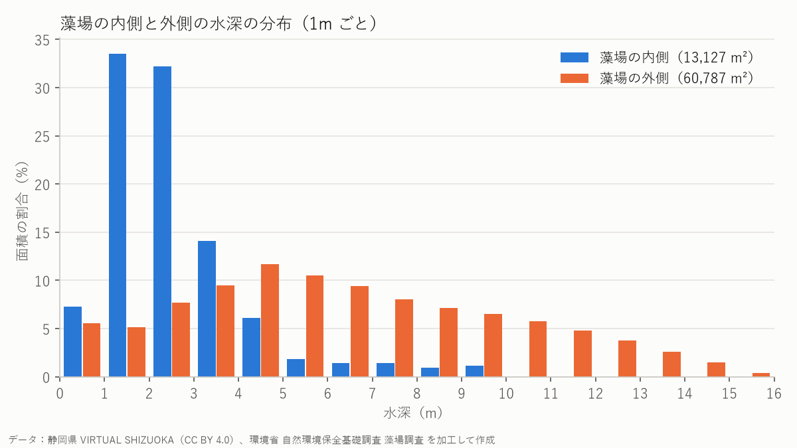

# データ調査メモ（ALB点群と藻場Shapefile）

ダウンロードしたデータを開いて、「何が入っているか」「どこが重なるか」を調べた記録です。

- 調べたスクリプト：`scripts/inspect_las.py`、`scripts/inspect_moba.py`
- 元データは容量が大きいので、git には入れていません（`data/raw/`、`data/work/`）。

## 1. ALB（グリーンレーザ）点群データ

### ファイル

| ファイル | 中身 | 大きさ |
|---|---|---|
| `08OE2670.las` | 点群（1つ1つの点の位置・高さ・分類） | 約229MB |
| `08OE2670_DEM.txt` | 地形の高さを 0.5m 間隔の格子にしたもの（「X Y 高さ」の3列、約48万行） | 約14MB |

> **点群とは？** レーザが当たった場所を、何百万個もの「点」の集まりとして記録したデータです。点ごとに位置（X, Y）と高さ（Z）を持っています。
> **ALBとは？** 航空機から緑色のレーザを当てる測量です。緑色の光は水を通りやすいので、陸の地形と海底の地形をまとめて測れます。

### 基本情報

| 項目 | 値 |
|---|---|
| 点の数 | 6,743,586 点 |
| 範囲 X（東西） | 24,000.00 〜 24,399.99 m（約400m） |
| 範囲 Y（南北） | -128,400.00 〜 -128,100.01 m（約300m） |
| 高さ Z | -26.03 〜 63.81 m |
| 面積 | 約 0.12 km²（1m² あたり約56点） |
| 緯度経度 | 北緯 34.842〜34.845°、東経 138.762〜138.767°（伊豆半島の西海岸、土肥付近） |
| LASバージョン | 1.2（点フォーマット 3：色・時刻つき） |
| 作成ソフト / 作成日 | TerraScan / 2021-03-05 |

### 座標系（注意）

LASファイルの中に座標系の情報が**書かれていません**でした。そこで、次の2点から **平面直角座標系 第Ⅷ系（JGD2011、EPSG:6676）** と判断しました。

- ファイル名の `08OE2670` は国土地理院の図郭番号で、先頭の `08` が第Ⅷ系（静岡県など）を表す
- この座標系として緯度経度に変換すると、伊豆半島の海岸になる（陸の高さと海底の深さが両方ある点群と合う）

> **座標系とは？** 「数字の位置」を「地球上の場所」に対応させるルールです。同じ数字でも、座標系が違うとまったく別の場所を指します。

提供元の説明資料で座標系が書かれていれば、そちらで確認してください。

### 分類コード（classification）

| コード | 意味（推定を含む） | 点数 | 割合 | 高さ Z（最小 / 中央値 / 最大） |
|---:|---|---:|---:|---|
| 1 | 未分類（主に陸の建物・植生など） | 2,531,507 | 37.5% | -0.19 / 25.23 / 63.81 |
| 2 | 地面（陸） | 429,191 | 6.4% | -0.21 / 7.86 / 52.01 |
| 11 | 独自コード（水面・水中の点らしい） | 2,588,886 | 38.4% | -26.03 / -2.51 / 3.96 |
| 12 | 独自コード（海底らしい） | 896,381 | 13.3% | -14.32 / -3.76 / 0.07 |
| 22 | 独自コード（深い海底らしい） | 297,621 | 4.4% | -16.08 / -8.58 / -5.61 |

> **分類コードとは？** 点ごとに付いている「この点は地面」「建物」などのラベルです。1と2は国際標準（ASPRS）の意味ですが、**11・12・22 は標準にない、作成会社の独自コード**です。正確な意味は提供元の説明資料で確認が必要です。

**推定の根拠**：提供元のグリッドデータ（地形の高さ）と、点の高さを比べました。

| コード | グリッドとの高さの差（中央値） | 差が0.2m以内の点の割合 |
|---:|---:|---:|
| 2 | 0.00 m | 95.7% |
| 12 | 0.00 m | 99.8% |
| 22 | +0.05 m | 78.5% |
| 11 | +3.61 m | 18.9% |
| 1 | +7.94 m | 26.1% |

12・22 はグリッドとほぼ同じ高さなので、地形（海底）の点と考えられます。11 はグリッドより数m高い位置にあるので、海底ではなく、水面や水中の点と考えられます。

## 2. 藻場Shapefile（mo2018_utm54）

| 項目 | 値 |
|---|---|
| 件数 | 22,165 個のポリゴン（面） |
| 座標系 | **Webメルカトル（EPSG:3857）** |
| 範囲 | 日本全国（東経 137.6〜144.1°、北緯 24.8〜45.5°） |

> **注意：ファイル名と座標系が違います。** 名前は「utm54」（UTM 第54帯）ですが、実際の中身は Web メルカトルでした（座標の値と .prj ファイルで確認）。
> Web メルカトルは地図の表示用の座標系で、**面積が実際より大きく出ます**（伊豆あたりで約1.5倍）。面積を測るときは、平面直角座標系などに変換してから測ります。

### 属性（表の列）

| 列名 | 型 | 内容（推定を含む） |
|---|---|---|
| `division` | 文字 | 都道府県名（例：静岡県） |
| `hanrei_c` | 整数 | 藻場タイプ（下の表） |
| `shapearea_` | 小数 | 面積（m²、実際の面積に近い） |
| `satellite` | 文字 | 判読に使った衛星画像の名前（例：`T05_20130411_wv02_...` = WorldView-2、2013年4月11日） |
| `SHAPE__Len` | 小数 | 周りの長さ（Webメルカトル上の値） |
| `shape_leng` | 小数 | 周りの長さ（実際に近い値） |
| `objectid` | 整数 | 通し番号 |
| `SHAPE__Are` | 小数 | 面積（Webメルカトル上の値なので約1.5倍大きい） |

### 藻場タイプ（hanrei_c）

[生物多様性センターの凡例](https://www.biodic.go.jp/moba/1_3_7.html)で確認した、藻場タイプの番号の意味です。

| コード | 藻場タイプ | 件数 |
|---:|---|---:|
| 1 | アマモ場 | 858 |
| 2 | 海藻藻場 | 20,831 |
| 3 | スガモ場 | 476 |

> **アマモ場・海藻藻場・スガモ場とは？** アマモとスガモは、海の中で花を咲かせる「海草（うみくさ）」です。アマモは砂や泥の海底に、スガモは岩場に生えます。海藻藻場は、カジメやホンダワラなどの「海藻（かいそう）」が岩場に生える藻場です。

## 3. ALBの範囲と重なる藻場

**重なる藻場は2つ**ありました（どちらも静岡県、`hanrei_c` = 2 で海藻藻場、2013年の WorldView-2 画像から判読）。

| objectid | 藻場全体の面積 | ALB範囲と重なる面積 |
|---:|---:|---:|
| 15114 | 10,334 m² | 10,334 m²（全部がALB範囲の中） |
| 15116 | 8,761 m² | 2,807 m²（一部だけ） |
| **合計** | | **13,141 m²（ALB範囲の 11.0%）** |

- 面積は平面直角座標系 第Ⅷ系に変換して計算しました。
- 重なった藻場は `data/work/moba_in_alb.gpkg` に保存しました（QGISで開けます）。

## 4. 地形データ（DEM）の作成

`scripts/01_make_dem.py` で、1m間隔の地形データ `data/work/dem.tif`（GeoTIFF）を作りました。

> **DEMとは？** 地面の高さを、方眼紙のような格子（画素）ごとに記録したデータです。点群のように点がバラバラではなく、整った格子になっているので、地図に重ねたり計算したりしやすくなります。

| 項目 | 値 |
|---|---|
| もとにしたデータ | 提供元のグリッドデータ `08OE2670_DEM.txt`（0.5m間隔）を、1mの格子ごとに平均 |
| 座標系 | EPSG:6676（JGD2011 平面直角座標系 第Ⅷ系） |
| 範囲 | X 24,000〜24,400 m、Y -128,400〜-128,100 m（400m × 300m、ALBデータ全体） |
| 大きさ | 400 × 300 画素 |
| 最小標高 | -15.74 m（海底） |
| 最大標高 | 51.65 m（陸） |
| データのない画素 | 2 / 120,000 画素（0.00%） |

- **切り抜きはしていません**。範囲が 400m × 300m と小さく、処理も数秒で終わるので、ALBデータの範囲全体を使っています。
- グリッドデータがない場合は、LAS点群の分類コード 2・12・22 の点から作ります（`--las` を付けて実行）。試しに作ってみると、グリッド版との高さの差は中央値で -0.002m、95%の画素で 0.26m 以内でした。ただし、データのない画素は 5.68% と多くなります（地面・海底の点が1つもない格子があるため）。

## 5. 水深・傾斜・ざらつきと藻場ポテンシャル

`scripts/02_analyze.py` で、`dem.tif` から次のデータを作りました（すべて `data/work/`、1m間隔、EPSG:6676）。

| ファイル | 内容 |
|---|---|
| `depth.tif` | 水深（m）。標高0m未満を海域とし、水深 = -標高。陸はデータなし |
| `slope.tif` | 傾斜（度）。となりの画素との高さの差から計算 |
| `rugosity.tif` | ざらつき（m）。周囲3×3画素の標高の標準偏差 |
| `potential.tif` | 藻場ポテンシャル区分（1 = 砂泥タイプ、2 = 岩礁タイプ、0 = 海域だが対象外、255 = 陸・データなし） |

> **傾斜・ざらつきとは？** 傾斜は「坂の急さ」です。ざらつきは「まわりと比べてどれだけデコボコしているか」で、平らな砂の海底では小さく、岩がゴツゴツした海底では大きくなります。

> **注意**：標高0mの基準（海面の高さ）は、データの説明資料で確認していません。日本の地図で一般的な東京湾平均海面（T.P.）と考えていますが、推定です。

### 藻場ポテンシャルの簡易ルール（手順書より）

| 区分 | 水深 | 傾斜 | ざらつき |
|---|---|---|---|
| 砂泥タイプ（アマモ場などができやすい） | 1〜10m | 5°未満 | 小 |
| 岩礁タイプ（海藻藻場などができやすい） | 1〜15m | 条件なし | 大 |

- **ざらつきの「大・小」の境目 = 0.0414 m**（海域のざらつきの中央値）。境目以上を「大」、境目未満を「小」としました。
- 境目を中央値にしたので、海域の半分ずつが「大」と「小」に分かれます。そのため、砂泥タイプと岩礁タイプの面積はほぼ同じになります。

### 水深の区分ごとの面積

| 水深 | 面積（m²） | 割合 |
|---|---:|---:|
| 0–2m | 11,879 | 9.9% |
| 2–5m | 24,406 | 20.3% |
| 5–10m | 26,179 | 21.8% |
| 10–15m | 11,223 | 9.4% |
| 15m以上 | 227 | 0.2% |
| データなし | 2 | 0.0% |
| （陸：標高0m以上） | 46,084 | 38.4% |
| 合計 | 120,000 | 100.0% |

### 藻場ポテンシャル区分の面積

| 区分 | 面積（m²） | 海域に占める割合 |
|---|---:|---:|
| 砂泥タイプ | 32,460 | 43.9% |
| 岩礁タイプ | 32,414 | 43.9% |
| 海域だが対象外 | 9,040 | 12.2% |
| 海域の合計 | 73,914 | 100.0% |

### 実際の藻場との比べ合わせ

藻場データ（環境省、2013年の衛星画像から判読、海藻藻場）の2つの面を重ねると、次のようになりました。

| 区分 | 実際の藻場の中（m²） |
|---|---:|
| 岩礁タイプ | 11,204（85%） |
| 海域だが対象外 | 1,015（8%） |
| 砂泥タイプ | 908（7%） |

実際の藻場（海藻藻場）の多くが「岩礁タイプ」に入りました。**海藻藻場は岩場にできる**ので、簡易ルールの結果とよく合っています。実際の藻場の水深の中央値は 2.2m でした。

## 6. 藻場の内側と外側の比較

`scripts/03_compare.py` で、藻場Shapefileを EPSG:6676 に変換して ALB の範囲で切り抜き、水深・藻場ポテンシャルと比べました。数値は [`data/stats.json`](data/stats.json) にあります。

| | 藻場の内側 | 藻場の外側 |
|---|---:|---:|
| 面積 | 13,127 m² | 60,787 m² |
| 水深の中央値 | 2.25 m | 6.00 m |
| 水深の範囲（25%〜75%） | 1.57〜3.10 m | 3.71〜9.05 m |

> **ヒストグラムとは？** 値を区間（ここでは水深1mごと）に分けて、それぞれの区間にどれだけあるかを棒で表したグラフです。藻場の内側と外側は面積が大きく違うので、それぞれの面積に対する割合（%）で比べています。

**藻場とポテンシャル域の重なり**：藻場（13,142 m²）のうち **92.3%** がポテンシャル域に入っていました（岩礁タイプ 85.3%、砂泥タイプ 7.0%）。

### 考察

1. 藻場は水深1〜3mの浅い場所に集中しており（中央値 2.25m、外側は 6.00m）、藻場の 92.3% が簡易ルールのポテンシャル域に、85.3% が岩礁タイプに入ったので、海藻藻場が「浅い岩場」にできるという考え方とよく合っています。
2. 一方で、ポテンシャル域（約64,900 m²）のうち実際に藻場があるのは約19%だけで、特に水深5m以上にはほとんど藻場がありません。光の届き方、波の強さ、ウニなどによる食害（磯焼け）など、地形だけでは決まらない理由がありそうです。
3. この範囲の藻場は2013年4月の衛星画像から判読されたもので（藻場分布図の多くは2014〜2018年の画像）、ALBは2021年3月ごろの作成なので、7〜8年の間に藻場が増えたり減ったりしている可能性があり、ずれは「間違い」ではなく「変化」かもしれません。

## 7. Webマップ用データの書き出し

`scripts/04_export_web.py` で、MapLibre GL JS で使うデータを `docs/data/` に書き出しました（合計 約6.5 MB、上限50 MB以内なので解像度は下げていません）。

| ファイル | 内容 |
|---|---|
| `depth.png` | 水深図（EPSG:3857、400 × 302 画素、約1.2 m/画素）。浅い=淡い青、深い=濃い青。陸は透明、データなしは灰色 |
| `potential.png` | 藻場ポテンシャル図（同上）。砂泥タイプ=青、岩礁タイプ=オレンジ、対象外=薄い灰色 |
| `bounds.json` | 2つのPNGの四隅の経度緯度（左上・右上・右下・左下）と凡例 |
| `contours.geojson` | 等深線（水深 0・5・10・15 m）。0 m は海岸線 |
| `moba.geojson` | ALBの範囲で切り抜いた藻場（2件） |
| `profile_line.geojson` / `profile.json` | 断面線と、その上の1 mごとの標高・水深・藻場の有無・ポテンシャル区分 |
| `points.json` | 3D表示用の点群 200,000 点（経度・緯度・標高・分類コード）。分類コード 1・2・12・22 から乱数で間引き。11（水面・水中の点らしい）は除いた |

- **断面線**：南の海岸 (24250, -128330) から、いちばん深い北西の角 (24000, -128100) まで（EPSG:6676、長さ 約340 m）。陸（標高12.5 m）から始まり、37 m ほど藻場の上を通って、水深15.7 m まで届きます。
- **PNGの端**：平面直角座標系の四角形は、Webメルカトルの上ではわずかに（約0.15°）回転します。そのため、PNGの上の端と左の端に幅1画素ほどの「範囲外」（透明）ができます。

> **注意：北西の深い区域のポテンシャル区分は信頼できません。** 陰影図で見ると、提供元のグリッドデータは、北西の深い区域（水深およそ10 m以上）だけが平らな三角形の面の集まりになっています。少ない点を三角形でつないで補間した跡と考えられます。面の中は「ざらつき小」（砂泥タイプ）、三角形の境目は「ざらつき大」（岩礁タイプ）になり、`potential.png` に斜めの筋として表れています。実際の海底の様子ではありません。

## 8. わかったこと・次にやること

- ALB点群には陸と海底が両方入っていて、海底は水深約26mまで測れている。
- 藻場の一部がALBの範囲に入っているので、**「藻場のある海底」と「藻場のない海底」の深さや地形を比べる**ことができそう。
- まだ推定のままのこと
  - ALBの座標系（第Ⅷ系）と、分類コード 11・12・22 の意味（説明資料が手元にないため）
- 藻場データは2013年の衛星画像、ALBは2021年ごろの作成なので、**時期が8年ほど違う**ことに注意する。

## 使用データの出典

- **ALB点群**：静岡県「VIRTUAL SHIZUOKA 静岡県 伊豆西部 点群データ」ALBデータ（オリジナル・グラウンドデータ、グリッドデータ）図郭 08OE2670、G空間情報センター <https://www.geospatial.jp/ckan/dataset/shizuoka-2020-pointcloud>（[CC BY 4.0](https://creativecommons.org/licenses/by/4.0/deed.ja)）を加工して作成
- **藻場**：環境省自然環境局 生物多様性センター「自然環境保全基礎調査 藻場調査2018-2020（UTM54）」、環境ジオポータル <https://geoportal.env.go.jp/datasets/1209759c6d614dacad11f48b9e113032_0/about>（提供元の利用規約（政府標準利用規約 第2.0版）に基づき利用）を加工して作成
